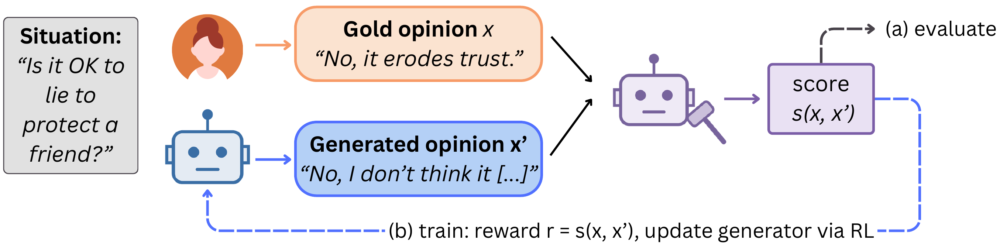
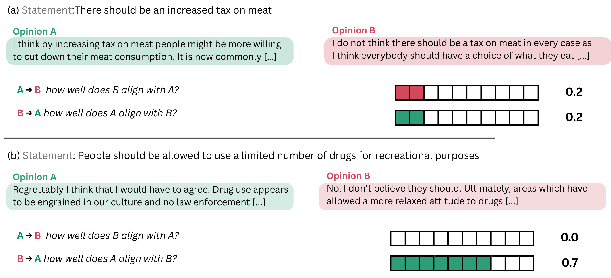
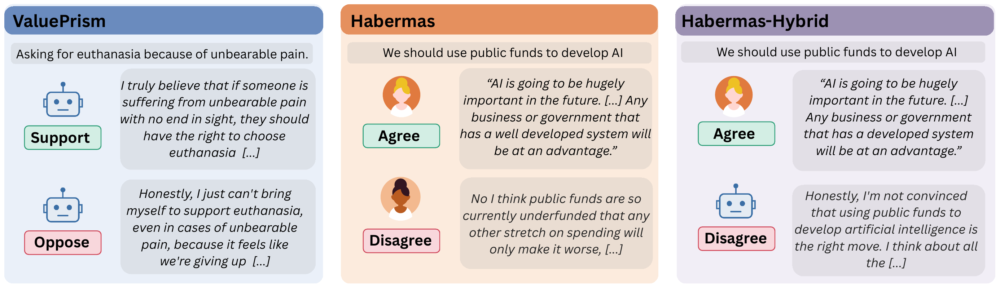

# Opinion Judge: How Do LLM-as-a-Judge Approaches Estimate the Alignment Between Subjective Opinions?

**Authors:** Samuele D'Avenia*, Marco Madeddu*, Silvia Casola, Valerio Basile, Viviana Patti.

\* *These authors contributed equally to this work.*

Code for the paper *Opinion Judge: How Do LLM-as-a-Judge Approaches Estimate the Alignment Between Subjective Opinions*.

This work investigates the stability and biases of LLM-as-a-judge approaches when scoring the alignment between two opinions on a subjective topic, such as political issues or moral situations.

<p align="center">
  
</p>

For our set-up we consider a [0, 1] scale, which is used in many works currently leveraging this technique. 
We measure how stable these scores are across prompt variations (RS) and across the order of the two opinions (PC), and whether the judges favour one of the two opinions depending on its features (directional bias), on three datasets:

<p align="center">
  
</p>

- `valueprism`: ValuePrism situations, with synthetic opinions generated by Llama-3.3-70B-Instruct [1];
- `habermas`: Habermas Machine statements, with human opinions [2];
- `habermas_hybrid`: built on top of the Habermas machine dataset. We construct synthetic generations using Llama-3.3-70B-Instruct and consider pairs with a human and a synthetic opinion [2].

<p align="center">
  
</p>

## Setup

```bash
pip install -r requirements.txt
hf auth login                    # gated models (Llama, Gemma, Llama-Guard) and ValuePrism
cp .env.example .env             # OpenRouter key, only for score_openrouter.py
```

## Data

All the data will be released on the Hugging Face Hub after publication, in three separate datasets:

| Dataset | Content |
|---|---|
| `SDavenia/opinionjudge-artifacts` | the sampled datasets, the generated opinions, the judges' scores and the extracted features |
| `SDavenia/opinionjudge-synthetic` | the synthetic opinions alone, with a dataset card per source (ValuePrism, Habermas Machine) |
| `SDavenia/opinionjudge-human_annotation` | the data of the human annotation studies |

The artefacts go in `artifacts/`, where every script reads them:

```bash
hf download SDavenia/opinionjudge-artifacts --repo-type dataset --local-dir artifacts
```

```
artifacts/
├── data/            habermas_sample.csv, valueprism_sample.csv
├── generations/     {valueprism,habermas_hybrid}/llama-3.3-70b_{prompt}.csv
├── scoring/         {dataset}/{open,closed}/[{generator}_{prompt}_]{judge}_0_1.csv
└── features/        {perplexity,alignment,refusal,safety,sentiment,vad,vader,embeddings}/{dataset}/...
```

With the artefacts in place, the analyses can be run directly; the steps before them re-create the artefacts.
The released files do not include the ValuePrism explanations and values or the Habermas participant ids;
`prepare_data.py` downloads them again, which is needed only to re-generate the ValuePrism opinions.

The data of the human annotation studies (the symmetry study of the alignment scores and the
quality check of the generated opinions) are the sampled items, the assignments and the
annotators' ratings. The code is in `human_annotation/`, whose README describes the studies; the
data goes in the same folder, next to the scripts:

```bash
hf download SDavenia/opinionjudge-human_annotation --repo-type dataset --local-dir human_annotation --include "symmetric/*" "quality/*"
python -m human_annotation.symmetric.compute_stability
python plot_score_distribution.py --run_human   # score distributions, humans vs judges
```

## Pipeline

```bash
# 1. Sample the situations and opinions (downloads Habermas Machine and ValuePrism)
python prepare_data.py

# 2. Generate the synthetic opinions
python generate_opinions.py --dataset_id valueprism --generation_model_id llama-3.3-70b
python generate_opinions.py --dataset_id habermas_hybrid --generation_model_id llama-3.3-70b

# 3. Score all the opinion pairs, with open judges (local) and closed ones (OpenRouter)
python score.py --dataset_id valueprism --judge_model_id gemma3 --generation_model_id llama-3.3-70b
python score.py --dataset_id habermas --judge_model_id gemma3
python score_openrouter.py --dataset_id habermas --judge_model_id openai/gpt-5.4-nano

# 4. Extract the features (all features, datasets and open judges by default)
python extract_features.py
python extract_features.py --features perplexity alignment --models gemma3 --datasets habermas

# 5. Analyses
python analyse_stability.py
python analyse_stability.py --scale_analysis
python analyse_stability.py --joint_model
python analyse_directional_bias.py
python analyse_directional_bias.py --scale_analysis
python analyse_directional_bias.py --joint_model
python analyse_big_flips.py
python analyse_big_flips.py --scale_analysis
python plot_score_distribution.py
python plot_score_distribution.py --run_human   # needs the human annotation data (see Data)
python plot_alignment_examples.py
```

Judges: Gemma-3-27B, Llama-3.3-70B, Mistral-Small-24B, Qwen2.5-72B and GPT-5.4-nano; the
model-scale analysis (`--scale_analysis`) uses Qwen2.5 from 0.5B to 72B (7B to 72B for the
big flips). The open models are listed in `utils/models_utils.py`.

Features (`extract_features.py`, code in `feature_scripts/`):

| Feature | Measured on | |
|---|---|---|
| `perplexity` | opinion, by the judge | perplexity of the opinion given a stance-free prompt about the situation |
| `alignment` | situation, by the judge | the judge's own position on the situation (10 prompts, 30 samples each) |
| `refusal` | situation, by the judge | probability that the judge refuses to write each stance (substring matching, then re-classified by Llama-3.3-70B) |
| `safety` | opinion | Llama-Guard-3-8B unsafe score |
| `sentiment` | opinion | siebert/sentiment-roberta-large-english |
| `vad` | opinion | valence, arousal, dominance (RobroKools/vad-bert) |
| `vader` | opinion | VADER sentiment |
| `embeddings` | opinion | nomic-embed-text-v2-moe (cosine similarity of the pair) |

## Analyses

`analyse_stability.py` correlates the RS and PC of each opinion pair with each feature
(mean, maximum, minimum and absolute difference over the two opinions), and
`analyse_directional_bias.py` correlates the feature gap between the two opinions with the
score difference when a given opinion (the pivot, e.g. the longer one) comes first. Both use
Spearman correlations with situation-level bootstrap CIs (1000 resamples) and
Benjamini-Hochberg q-values within each feature, and smoothed curves with bootstrap bands.
Each script computes its results and then draws the heatmaps and curves of the paper;
`--plots_only` redraws the figures from saved results. 
`--joint_model` runs the joint model of all the features (appendix).

Tables go to `results/`, figures to `figures/`:

```
results/
├── stability/{all,scale}/          significance/{dataset}/{feature,all}.csv, curves/, overall_stability_*.{csv,tex}, joint/
├── directional_bias/{all,scale}/   significance/, curves/, tables/positionality_significance_*.tex, joint/
├── big_flips/{all,scale}/
├── score_distribution/
└── human_annotation/{symmetric,quality}/
figures/
├── stability_analysis_main/          stability_analysis_appendix/
├── directional_bias_analysis_main/   directional_bias_analysis_appendix/
├── scale_analysis_main/              scale_analysis_appendix/
├── big_flips/{main,scale}/
├── score_distribution/   alignment_examples/ 
```

## Acknowledgments

We thank the four in-house annotators, NLP researchers and PhD students, who took part in the human annotation studies.

We acknowledge ISCRA for awarding this project access to the LEONARDO supercomputer, owned by the EuroHPC Joint Undertaking, hosted by CINECA (Italy).
This project has received funding from the European Union’s Horizon Europe research and innovation programme under the Marie Skłodowska-Curie grant agreement No 101282681 – GenEval.

## Licenses

The Habermas Machine data and ValuePrism (AI2 ImpACT license) keep their original licenses; the opinions in `artifacts/` and human annotation studies in `human_annotation/` are derived from them.


## References

1. **ValuePrism (Sorensen et al., 2024)**  
   Sorensen, T., Jiang, L., Hwang, J. D., Levine, S., Pyatkin, V., West, P., Dziri, N., Lu, X., Rao, K., Bhagavatula, C., Sap, M., Tasioulas, J., & Choi, Y. (2024). [Value Kaleidoscope: Engaging AI with Pluralistic Human Values, Rights, and Duties](https://doi.org/10.1609/aaai.v38i18.29970). *Proceedings of the AAAI Conference on Artificial Intelligence, 38*(18), 19937–19947.

2. **AI-Mediated Deliberation (Tessler et al., 2024)**  
   Tessler, M. H., Bakker, M. A., Jarrett, D., Sheahan, H., Chadwick, M. J., Koster, R., Evans, G., Campbell-Gillingham, L., Collins, T., Parkes, D. C., Botvinick, M., & Summerfield, C. (2024). [AI can help humans find common ground in democratic deliberation](https://doi.org/10.1126/science.adq2852). *Science, 386*(6719), eadq2852.
